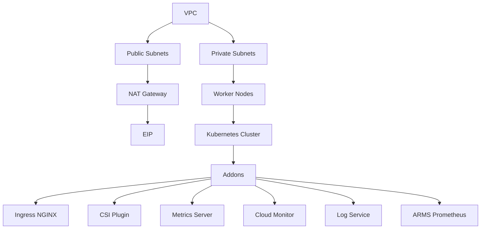

# 🚀 Alibaba Cloud Kubernetes Infrastructure with Terraform

[](https://www.terraform.io/)
[](https://www.alibabacloud.com/)
[](https://kubernetes.io/)

This repository provides a production-ready Terraform configuration for deploying a secure, scalable Kubernetes infrastructure on Alibaba Cloud. The infrastructure follows cloud-native best practices and includes essential components for monitoring, logging, and security.

## 📋 Table of Contents

- [Architecture](#-architecture)
- [Features](#-features)
- [Prerequisites](#-prerequisites)
- [Quick Start](#-quick-start)
- [Configuration](#-configuration)
- [Security](#-security)
- [Monitoring](#-monitoring)
- [Cleanup](#-cleanup)
- [Contributing](#-contributing)
- [License](#-license)

## 🏗️ Architecture



### Infrastructure Components

1. **VPC Module**
   - Virtual Private Cloud with public/private subnets
   - NAT Gateway for secure outbound access
   - Elastic IP for NAT Gateway
   - SNAT entries for private subnet internet access

2. **Security Module**
   - Security groups with configurable rules
   - Default rules for Kubernetes and database access
   - VPC CIDR-based rule substitution

3. **Kubernetes Module**
   - Managed Kubernetes Service (ACK)
   - Auto-scaling worker node pool
   - Essential addons for production workloads

## ✨ Features

- 🔒 Secure by design with private subnets and NAT Gateway
- 📈 Auto-scaling worker nodes
- 📊 Built-in monitoring and logging
- 🔄 High availability across multiple AZs
- 🛡️ Security groups with minimal required access
- 📦 Essential Kubernetes addons pre-configured

## 📋 Prerequisites

- Alibaba Cloud account with appropriate permissions
- Terraform v1.0.0 or later
- Alibaba Cloud CLI configured with credentials
- kubectl for Kubernetes interaction

## 🚀 Quick Start

1. Clone the repository:
   ```bash
   git clone https://github.com/yourusername/alicloud-k8s-terraform.git
   cd alicloud-k8s-terraform
   ```

2. Configure your variables in `infra-services/terraform.tfvars`:
   ```hcl
   # Basic Configuration
   name_prefix = "your-prefix"
   region     = "ap-southeast-5"
   
   # VPC Configuration
   vpc_name = "your-vpc"
   vpc_cidr = "10.0.0.0/16"
   availability_zones = ["ap-southeast-5a", "ap-southeast-5b"]
   
   # Kubernetes Configuration
   k8s_version = "1.26.3"
   k8s_worker_instance_type = "ecs.g6.xlarge"
   k8s_worker_nodes_count = 2
   ```

3. Initialize and apply:
   ```bash
   cd infra-services
   terraform init
   terraform plan
   terraform apply
   ```

## ⚙️ Configuration

### Module Structure
```
.
├── modules/
│   ├── kubernetes/         # Kubernetes cluster and node pool
│   ├── security-group/     # Security groups and rules
│   └── vpc/               # VPC, subnets, and NAT gateway
└── infra-services/        # Main infrastructure configuration
    ├── main.tf           # Module composition
    ├── variables.tf      # Variable declarations
    └── terraform.tfvars  # Variable values
```

### Key Configuration Options

- **VPC**: CIDR block, availability zones
- **Kubernetes**: Version, worker node configuration
- **Security**: Ingress/egress rules
- **Addons**: Monitoring, logging, and storage options

## 🔒 Security

- Private subnets for worker nodes
- NAT Gateway for controlled outbound access
- Security groups with minimal required access
- Managed Kubernetes service for security updates
- Cloud Monitor and ARMS for security monitoring

## 📊 Monitoring

The infrastructure includes comprehensive monitoring:

- **Cloud Monitor**: Basic infrastructure metrics
- **ARMS Prometheus**: Advanced Kubernetes monitoring
- **Log Service**: Centralized logging
- **Metrics Server**: Kubernetes metrics

## 🧹 Cleanup

To destroy all resources:
```bash
cd infra-services
terraform destroy
```

## 🤝 Contributing

1. Fork the repository
2. Create a feature branch
3. Commit your changes
4. Push to the branch
5. Create a Pull Request

## 📄 License

This project is licensed under the MIT License - see the [LICENSE](LICENSE) file for details.

## 🙏 Acknowledgments

- [Alibaba Cloud](https://www.alibabacloud.com/)
- [Terraform](https://www.terraform.io/)
- [ACK Documentation](https://www.alibabacloud.com/help/en/container-service-for-kubernetes)